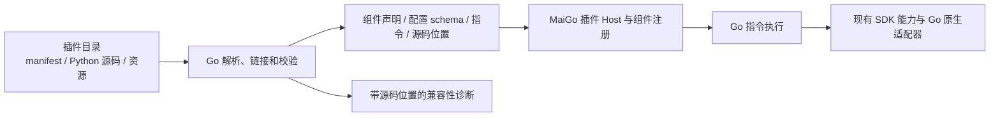

# 用 Go 静态转换 MaiBot Python 插件的设计评估

评估基线为 MaiGo `03b0ed2`、MaiBot 上游 `edf42446`，日期为 2026 年 11 月 20 日。

## 建议范围

**可行方案是把 MaiBot SDK 插件中可静态判定的 Python 源码编译成带类型和资源限制的中间指令，由 Go 执行。** 插件安装和运行都使用 Go。目标发行版接受经过转换的插件与现有 Go 原生适配器，省去 Python Runner、解释器、venv 和 pip。插件作者可以继续维护 Python 源码。

兼容性以完整插件和具体版本为单位。能解析语法、能读取装饰器和能完整运行是三个独立的验收结果。首版承诺覆盖经过测试的 MaiBot SDK 子集。Python 插件可在导入、类定义、装饰器或工厂中执行任意逻辑，依赖也可能接受运行时动态选择。静态编译遇到无法解析的行为时，显示具体文件、行号和缺失能力，整包保持待适配状态。

使用现有榫卯机制把转换后端加入启动装配。原版对齐发行版可继续作为迁移对照。静态发行版的插件执行由编译后的指令和已存在的 Go 原生实现承担，安装、启动和管理使用同一兼容性判定。 [榫卯说明](../../README.md) · [现有执行插槽](../runtime/execution/policy/policy.go) · [MaiBot 原版加载器](https://github.com/Mai-with-u/MaiBot/blob/edf42446/src/plugin_runtime/runner/plugin_loader.py)

## 源码与原型验证

用 Go Tree-sitter Python 语法解析六个真实插件目录，统计直接以 SDK 名称书写的组件装饰器。以下数字是语法扫描结果，组件声明、生命周期、配置和依赖仍需分别验证。

| 样本 | 扫描结果 | 转换评估 |
| --- | --- | --- |
| 麦麦小工具 | 6 个 Python 文件，2 个 Hook | 关键词反应适合先验证。错字功能还需接入共用的 Go jieba、规则模式的词频与多音字数据，以及两种模式的随机与纠正语义。两个 Hook、配置及重载都通过后，再替换线上整个插件。 |
| 线上游戏插件 `partner-game 2.0.2` | 4 个 Python 文件，24 个 Command | 声明、纯业务计算和部分 SDK 调用可转换。完整插件还依赖 `aiohttp` 头像下载、`os` 文件操作和原子替换、异步延迟保存、Pydantic 校验，以及 SnowLuma/NapCat API。移除线上最后一个第三方 Python 依赖，需要补足这些行为或提供此插件的 Go 移植。 |
| SnowLuma、QQ 官方、Telegram、微信 | 扫描了 73 个 Python 文件。SnowLuma 单独有 175 个直接 API 装饰器 | 继续使用已有 Go 原生适配器。转换层的首版范围集中于消费这些适配器 API 的社区插件。 |

原型直接从仓库的 `keyword_reaction.py` 读取 `_replace_capture_groups`。Go 将它编译为 24 条中间指令并执行，覆盖循环解包、字典迭代顺序、f-string、短路 `or` 和字符串替换。4 组结果通过，包含未命中的占位符、值为空和前一次替换结果被下一组继续匹配。另验证了未知调用与指令额度耗尽的失败路径。原型使用清空后的运行环境，PATH 仅包含 Go 探针所在目录。这个验证覆盖真实辅助函数，完整正则搜索、SDK 注册、插件装载和卸载仍待实现。

[关键词源码](../../plugins/built_in/chinese_typo/keyword_reaction.py) · [错字插件入口](../../plugins/built_in/chinese_typo/plugin.py) · [游戏插件 2.0.2](https://github.com/onelxzy/partner-game/tree/e36bdeb88411ce790b01ff9d7bce51a2fa364f75) · [SnowLuma 源码](https://github.com/Mai-with-u/MaiBot-SnowLuma-Adapter/tree/2878783) · [原生适配器注册表](../platform_io/native_runtime.go)

## 转换与执行设计

### 安装和更新时编译

1. 复用 manifest 版本和依赖检查语义。目录索引只读取规范化的插件源码与资源路径，校验归档大小、文件数和符号链接。固定导入根为当前包、静态 SDK 声明和受支持的依赖，解析图可重复构建。
2. 用语法树提取字面量、常量和可静态求值的 SDK 声明。首批接受显式的 `MaiBotPlugin` 子类、`create_plugin` 返回唯一已知类型，及参数可静态解析的 `HookHandler`、`Command`。配置从受支持的 `PluginConfigBase`、`Field` 和类型注解生成，保留默认值、枚举、约束、UI 元数据和版本。后续增加有确定语义的字段校验器。
3. 从组件、工厂、初始化、配置校验器与生命周期函数建立调用图，接着编译可达代码。模块顶层只接受定义、受支持导入和可静态求值的表达式。引用按绑定后的符号解析，同名普通函数与 SDK 装饰器有不同语义。Tree-sitter 可用于语法前端，语法错误恢复节点须视为编译失败。原型用官方 C grammar 绑定，项目已有 cgo 构建。发布前测 Alpine 静态链接、Windows 构建和各架构包体。也可以将编译器打包为独立 Go 命令，使运行进程只加载中间指令。
4. 输出可校验的制品，包含现有 `RegisterPluginPayload`、指令和常量、函数与组件索引、源码位置及声明的能力集合。用源码、资源、依赖绑定、编译器与 SDK 协议版本共同计算摘要。内容或 ABI 变化时重新编译。候选制品通过验证再发布，失败时保留可用的上一版及其数据。

[注册协议](protocol/payloads.go) · [组件注册](host/component_hooks.go) · [依赖报告](dependency_report.go)

### 保留 MaiGo 的组件与能力语义

- 把 RPC 中与传输无关的注册校验抽到 Host。静态后端复用组件注册、Hook 优先级、命令作用域、会话开关、错误码和 WebUI 声明。已有本地 API 处理器和 Hook `Subscription.Handler` 可作接入参照。同时审计通用组件、配置与重载中依赖 `activeRPCServer` 或 `HasActiveRunner` 的分支，通过插件 ID 定位执行后端。Hook 的超时、熔断、阻塞模式、修改参数和终止规则沿用现有可观察行为。 [Hook 分派](hooks/dispatch.go) · [组件调用](host/host_invoke.go) · [配置应用](host/host_apply_config.go)
- 静态组件的 `ctx.send`、`ctx.api`、日志和持久化通过 Go 宿主能力调用。现有 `InvokeCapability` 直接查表执行，授权检查在 RPC 层。需要抽取共享的插件身份与能力检查入口，调用身份由实际插件实例携带。能力权限、会话范围、速率和并发限制均在 Host 生效。对插件间调用校验调用方、目标 API 与版本。 [RPC 授权](host/rpc_dispatch.go) · [能力注册与调用](host/host.go) · [能力列表](CAPABILITIES.md)
- 运行态按 Bot 和插件分别持有，指令与常量可只读共享。Python `await` 映射到显式的宿主异步操作并沿用请求取消。状态更新顺序、回调并行方式和卸载保存行为以参考插件为准。配置修改先校验、再置换版本。热更新先在后台编译并验证新版，旧版停止接新调用并有界排空，再按生命周期提交新版注册与状态。涉及外部写入时，明确提交点和可迁移状态，保证失败重试的消息和数据一致性。
- 执行只允许有限的指令、值类型和声明过的宿主函数。为编译与调用分别设置源码大小、指令数、栈深、内存估算、运行时限、并发和队列字节预算。正则、媒体和网络加入单独的预算与取消策略。映射和列表通过独立值传递，只有正式 Hook 结果才能修改 Host 参数。读取资源限插件目录，写持久化状态限实例目录，HTTP 使用受控能力。 [现有 Hook 协议](hooks/spec.go) · [生命周期](host/host_shutdown.go)

### 语言和库的兼容策略

| 层级 | 支持方式 |
| --- | --- |
| 主要 Python 语义 | 首版覆盖有确定类型的变量、函数、分支、循环、基本推导式、f-string、受限异常、`None`、字典与列表，以及调用所需的 `**kwargs`。用差分样本固定真值、短路、字典顺序、Unicode、切片和数值行为。未实现的混合类型、溢出语义或动态属性在编译时拒绝。 |
| SDK 和装饰器 | 把已知 SDK 符号绑定到固定语义和现有 Host 协议。普通用户装饰器、元类、自定义描述符、运行时改写类、动态导入、`eval` 等进入诊断。 |
| 标准库 | 按函数和行为逐项适配。JSON、日期、随机、正则和文件存储分别用契约测试覆盖。Go RE2 与 Python `re` 的 Unicode 类、命名组和回溯特性存在差异。动态规则要在启用或改配置时校验，并按插件原约定处理非法规则与不支持的语法。 |
| 外部包 | 只绑定显式声明并经过验证的 Go 对应实现。`jieba` 可复用现有 Go 分词，`pypinyin` 需固定数据版本并核对多音字和词级结果。`aiohttp` 的具体请求和下载场景可映射到宿主 HTTP 能力。超出绑定范围的插件需要改写或移植，诊断保留具体包、符号及源码位置。 |

生成 Go 源码适用于随发行版审查、测试、构建的原生移植，运行时替换第三方插件需要新的二进制或构建链。中间指令适合安装时编译并热更新，且便于控制资源和显示源码错误。若后续测试证明隔离或吞吐有收益，可以将同一中间指令编译到 WebAssembly，由 Go 执行；把 Python 解释器编到 WebAssembly 仍需提供整套 Python 运行时。

## 零 Python 发行及验证顺序

| 阶段 | 交付与验收 |
| --- | --- |
| 1. 静态检查与 SDK 契约 | 在无 Python 的环境中完成源码扫描、依赖解析和定位诊断。跑通实际 Hook、Command 与配置的编译、调用及错误返回。WebUI 展示可转换版本、缺失依赖和报错位置。 |
| 2. 第一批真实插件 | 完成麦麦小工具两个 Hook、原始配置及重载。固定时钟和随机输入，对照原版 Runner 的分词、错字、关键词、顺序和媒体字段透传。参考 Runner 只在独立开发或 CI 环境用于差分验证。 |
| 3. 补齐线上插件组合 | 验证 `partner-game 2.0.2` 的全部 24 个命令、既有 JSON 状态、并发群聊写入、退出落盘、头像与合并转发。若使用该插件的原生移植作为首个零 Python 发行的组成部分，使用同一组验收用例。 |
| 4. 发布和测量 | 从安装器和运行镜像移出 Python、pip 与 venv，把内置插件源码或制品随发布包分发。Dashboard 可由构建环境解包为静态资产。当前 `MAIBOT_PLUGIN_SPAWN=0` 还会绕过启动主线中的原生适配器迁移、注册或 watcher，须先拆开这些步骤，再让静态模式启动。覆盖首次安装、滚动升级、待适配插件、热更新、服务重启和回滚。以当前插件组合做 cgroup、PSS、GC CPU 和端到端延迟对照。 |

已有内存报告测得，双插件且错字规则预热时的峰值约为 391 MiB PSS。只加载游戏插件的对照组约为 232 MiB，游戏插件所在的 Python 进程约为 43 MiB PSS。转换两个插件才有机会同时移除这部分 Runner 常驻和重复词典，实际节省需扣除 Go 指令执行、兼容绑定、词典和插件状态。先以 300 MB 做完整功能验证。200 MB 仍要把 A_Memorix、SQLite 与媒体同时纳入峰值预算。

[启动装配](../bootstrap/main.go) · [Docker 构建](../../Dockerfile) · [systemd 安装器](../../deploy/host/install.sh) · [运行时内存报告](../../deploy/host/memory-optimization.md)
